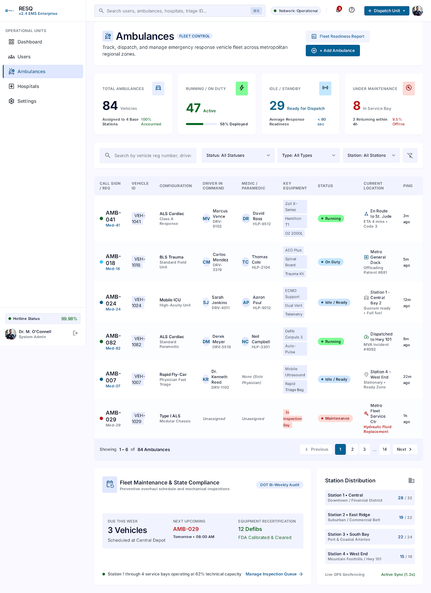
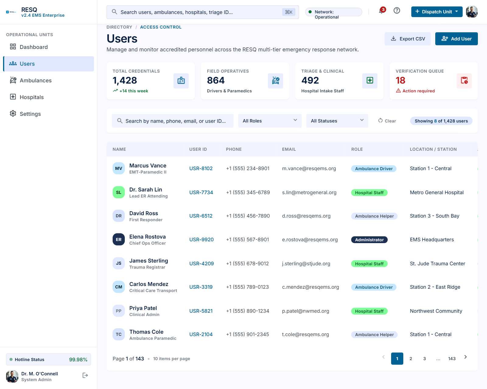
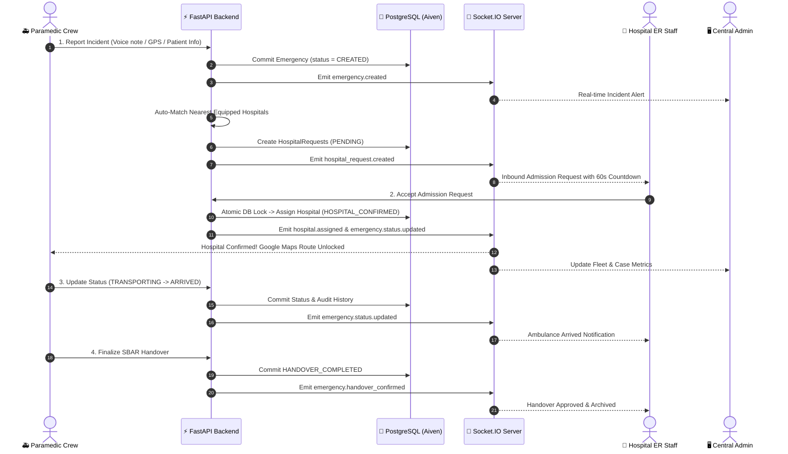

# 🚨 RESQ — Emergency Response Coordination System (ERCS)

[](https://fastapi.tiangolo.com)
[](https://react.dev/)
[](https://socket.io/)
[](https://www.postgresql.org/)
[](https://groq.com/)
[](https://elevenlabs.io/)

**RESQ (ERCS)** is a modern, life-critical emergency healthcare platform designed to eliminate emergency triage delays. It connects **Ambulance Field Paramedics**, **Regional Hospital ERs**, and **Central Administrative Dispatchers** in genuine real time.

When an emergency happens, every second counts. RESQ automates clinical speech-to-text, matches the best available hospital with matching specialized beds, locks admission concurrency-safely, and streams live telemetry without polling lag.

---

## 📸 System Overview & Live Dashboards

### 1. Central Command & Dispatch Dashboard
> High-level oversight for dispatchers: fleet status, active emergency distribution, hospital triage queues, and operational metrics.


### 2. Hospital Emergency Network & Live Capacity
> Real-time hospital status, ER/ICU bed availability, trauma capabilities, and active inbound admission requests.


### 3. Ambulance Fleet Tracking & Unit Status
> Field vehicle telemetry, active paramedic assignment, vehicle capability tiers (ALS/BLS), and operational readiness.


### 4. Role-Based Access Control & User Directory
> Authenticated personnel management for central administrators, hospital trauma doctors, and ambulance paramedics.


---

## ⚡ The Core Problem & How RESQ Solves It

| Traditional Emergency Dispatch | The RESQ Solution |
| :--- | :--- |
| ❌ Paramedics radio hospitals one by one while driving. | ✅ **One-Click Hospital Matching**: Finds the nearest hospital with matching beds in milliseconds. |
| ❌ Two ambulances head to the same ER bed simultaneously. | ✅ **Concurrency-Safe Atomic Locking**: PostgreSQL `SELECT ... FOR UPDATE` prevents double-booking. |
| ❌ Manual paper handovers cause communication errors. | ✅ **Groq Clinical AI + ElevenLabs**: Radio speech is converted to structured SBAR clinical summaries. |
| ❌ Websites refresh every 2–5 seconds with stale data. | ✅ **Genuine Socket.IO WebSockets**: Instant event broadcast across hospital, ambulance, and admin rooms. |

---

## 🔄 How It Works: The Emergency Lifecycle



---

## 🔑 Demo & Test Credentials

The backend comes pre-seeded with test accounts. Use these credentials to sign in and test the system:

| Role | Email | Password | Access Scope |
| :--- | :--- | :--- | :--- |
| 🛡️ **Administrator** | `admin@ercs.org` | `Admin123!` | System-wide analytics, fleet oversight, and hospital approvals. |
| 🏥 **Hospital Staff** | `hospital@ercs.org` | `Hospital123!` | Metro General ER (`HOSP-METRO-01`), bed capacity, admission requests. |
| 🚑 **Ambulance Crew** | `ambulance@ercs.org` | `Ambulance123!` | Unit `AMB-UNIT-101`, scene incident capture, AI handover. |

> **Tip**: All login portals feature a **1-click prefill** button to log in instantly.

---

## 🏗️ Repository Architecture

This repository is organized into three clean services:

```
RESQ_Hackathon/
├── backend/                  # FastAPI 0.115+ REST & Socket.IO server
│   ├── app/
│   │   ├── core/             # Socket.IO rooms, JWT security, logging
│   │   ├── models/           # SQLAlchemy 2.0 PostgreSQL database models
│   │   ├── routers/          # REST route controllers (Auth, Hospital, Emergencies)
│   │   └── services/         # Hospital matching, Groq AI, ElevenLabs Scribe
│   └── tests/                # 110 automated tests (100% pass)
│
├── frontend/                 # React 19 + TypeScript + Vite + Tailwind CSS
│   ├── src/
│   │   ├── features/admin/   # Admin real-time metrics & management
│   │   ├── features/hospital/# Hospital triage command & live admission requests
│   │   ├── lib/socket.ts     # Centralized Socket.IO client & state sync
│   │   └── tests/            # Vitest unit and integration test suite
│   └── package.json
│
├── ambulance-mobile/         # React Native (Expo) field ambulance application
│   ├── src/
│   │   ├── app/              # Paramedic scene dispatch & voice logging
│   │   ├── context/          # Real-time state & reconnection management
│   │   └── services/         # GPS Location & Socket.IO client service
│   └── tests/                # Jest mobile test suite
│
└── docs/screenshots/         # Application visual reference images
```

---

## 🚀 Quickstart Guide (Run Locally in 5 Minutes)

### Prerequisites
- **Python 3.10+**
- **Node.js 18+** & **npm**

---

### Step 1: Start the Backend API & Socket.IO Server

1. Open your terminal and enter the `backend` folder:
   ```bash
   cd backend
   ```
2. Create and activate a virtual environment:
   ```bash
   python3 -m venv venv
   source venv/bin/activate    # On Windows: venv\Scripts\activate
   ```
3. Install dependencies:
   ```bash
   pip install -r requirements.txt
   ```
4. Start the server:
   ```bash
   uvicorn app.main:app --host 0.0.0.0 --port 8000 --reload
   ```
   - **Backend API**: [http://localhost:8000](http://localhost:8000)
   - **Interactive Swagger Docs**: [http://localhost:8000/docs](http://localhost:8000/docs)
   - **Socket.IO Endpoint**: `ws://localhost:8000/socket.io`

---

### Step 2: Start the Web Dashboard (Admin & Hospital)

1. Open a new terminal and navigate to `frontend`:
   ```bash
   cd frontend
   ```
2. Install dependencies:
   ```bash
   npm install
   ```
3. Start the Vite development server:
   ```bash
   npm run dev
   ```
4. Open your browser at [http://localhost:5173](http://localhost:5173):
   - Sign in as **`admin@ercs.org`** to access `/admin/dashboard`
   - Sign in as **`hospital@ercs.org`** to access `/hospital/dashboard`

---

### Step 3: Start the Mobile Application (Ambulance Crew)

1. Open a new terminal and navigate to `ambulance-mobile`:
   ```bash
   cd ambulance-mobile
   ```
2. Install dependencies:
   ```bash
   npm install
   ```
3. Run the mobile application:
   ```bash
   npm start
   ```
   - Press **`w`** to open in web browser preview, or scan the QR code with **Expo Go** on your physical phone.
   - Sign in with **`ambulance@ercs.org`** to report incidents and receive hospital confirmations.

---

## 📡 Real-Time Socket.IO Synchronization

The application features full real-time bidirectional synchronization without periodic polling:

| Event Name | Who Receives It | Purpose |
| :--- | :--- | :--- |
| `emergency.created` | Admin, Assigned Ambulance | New emergency incident reported |
| `hospital_request.created` | Target Hospital, Admin | Instant admission request dispatched with countdown |
| `hospital_request.accepted` | Hospital, Admin | Request marked accepted |
| `hospital_request.declined` | Hospital, Admin, Emergency | Request declined; escalates if all reject |
| `hospital.assigned` | Emergency, Hospital, Ambulance, Admin | Official hospital destination confirmed |
| `emergency.status.updated` | Emergency, Ambulance, Hospital, Admin | Lifecycle update (`TRANSPORTING`, `ARRIVED`, etc.) |
| `emergency.location_updated`| Emergency, Ambulance, Hospital, Admin | Incident scene coordinate updates |
| `ambulance.location_updated`| Ambulance fleet, Admin, Active cases | Live ambulance GPS telemetry |
| `emergency.handover_confirmed`| Hospital, Ambulance, Admin | SBAR clinical handover signed off |

### Privacy & Authorization Invariants
- **No Patient PII over Broadcasts**: Event envelopes never broadcast sensitive names, contact details, or full medical histories over public channels.
- **Strict Role-Based Rooms**: Handshake tokens (`JWT`) are validated at connection time. Sockets are restricted strictly to permitted rooms (`hospital:{id}`, `ambulance:{id}`, `emergency:{id}`, `admin`).

---

## 🧪 Testing & Verification

The entire repository is covered by automated unit and integration tests:

### Run Backend Tests (110 Tests)
```bash
cd backend
python3 -m pytest
```
*Output: `110 passed in 25s` (covers auth, concurrency, matching, socket events, and transaction rollback).*

### Run Frontend Tests (81 Tests)
```bash
cd frontend
npm test
```
*Output: `81 passed` (covers dashboards, countdowns, real-time cache updates, error states, and role guards).*

### Run Mobile Tests (14 Tests)
```bash
cd ambulance-mobile
npm test
```
*Output: `14 passed` (covers incident reporting, AI extractions, GPS sync, and socket event listeners).*

---

## 👥 Contributors & Hackathon Team

Built with ❤️ for high-reliability emergency response coordination.  
For technical inquiries or integration specifications, please open an issue in this repository.